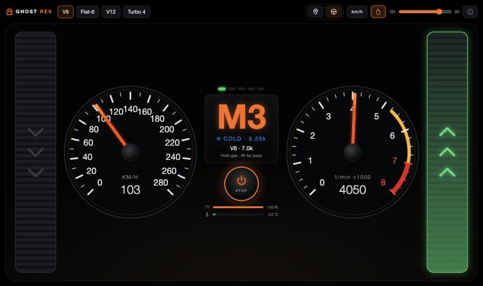
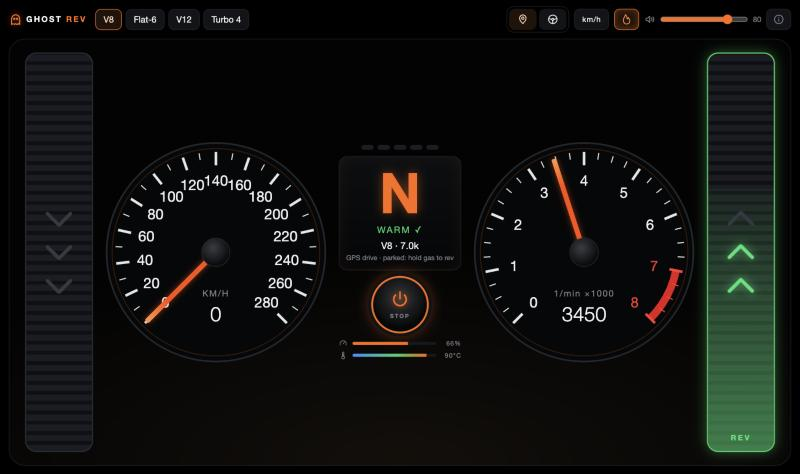

# GhostRev 👻

**Your EV's combustion ghost.** It plays real engine sound for an electric car, driven by your GPS speed. It's made for the Tesla browser.

### ▶ [andiq123.github.io/GhostRev](https://andiq123.github.io/GhostRev/)

| Test drive | GPS mode, parked rev |
|---|---|
|  |  |

## How to use

1. In the car, open the link above in the browser and allow location access.
2. Pick an engine and press the power button.
3. Drive. Gears, rpm and exhaust pops follow your real speed, acceleration, hills and corners. While parked, hold the gas pedal to rev.

**Test** mode works anywhere: hold the gas pedal (or ↑ / Space), then let go to hear the pops.

## Features

- **Real recordings:** the sound is built from real engine recordings. Each moment plays a recorded firing pulse that matches the current rpm and throttle, so there's no repeating loop.
- **Four engines:** V8, flat-six, V12 and turbo four.
- **Real exhaust pops** when you lift off and on full-throttle upshifts.
- **Start-up check:** needle sweep, system checks, starter cranking and a cold fast idle.
- **Warm-up:** a cold engine gets a lower rev limit (the amber arc on the tach), and the coolant temperature is remembered between drives.
- **Automatic gearbox:** rev-match blips on downshifts, shift lights and a soft limiter.
- **Lightweight:** one HTML file and no dependencies. Only the selected car's sounds load (about 200 KB).

## Run locally

```bash
python3 -m http.server 8765
```

Then open http://localhost:8765. GPS needs HTTPS, so for real driving use the GitHub Pages link.

## Credits

The engine and exhaust sounds come from recordings on [Wikimedia Commons](https://commons.wikimedia.org/) under CC BY 3.0, by Neighborhood Car Reviews, CARSMANIA, Luxury Cars Videos and FiExhaust. Each file is linked from the ⓘ button in the app. GhostRev isn't affiliated with any car maker.
